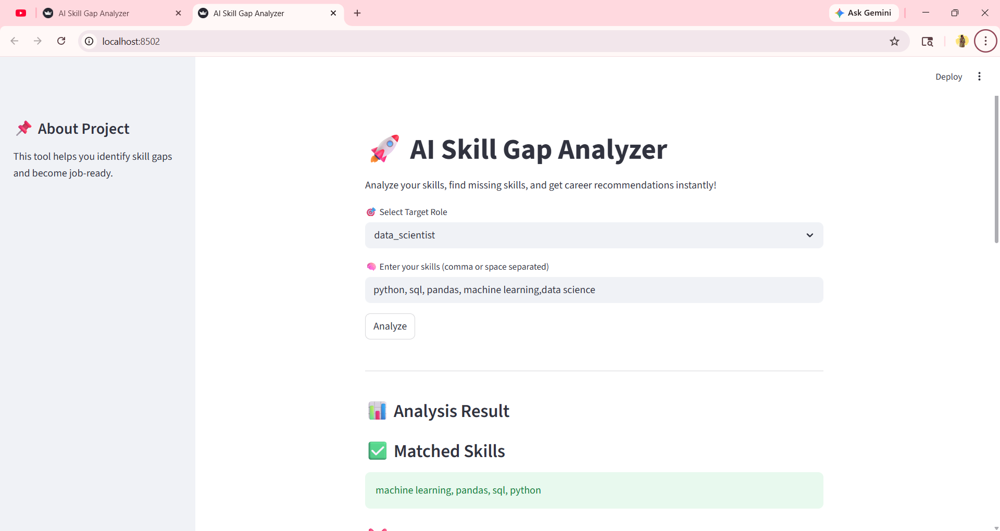

# Skill Gap Analyzer

A lightweight Streamlit app that compares a user's skills with a target career role, highlights gaps, calculates a readiness score, and suggests related roles.

> **Current implementation:** rule-based skill matching against a curated skills database. It is not an LLM-powered system.

## Features

- Choose from roles across data, software, DevOps, cybersecurity, business and marketing
- Enter skills using comma-separated input
- Canonicalize common aliases (for example, `py` → `python`, `js` → `javascript`)
- View matched, missing and additional skills
- Calculate a role-specific readiness percentage
- Suggest related roles based on skills
- Explore related role mappings for additional skills

## Preview



## How the analysis works

1. Select a target role.
2. Enter the skills you know.
3. The app normalizes skill aliases and compares your skills against that role's required skill list.
4. It displays matched, missing and additional skills, plus a readiness score.
5. It ranks roles based on skill overlap and shows related role mappings.

The readiness score is a simple coverage metric:

`matched required skills / total required skills × 100`

It is an indicative checklist score—not a validated employability or job-readiness prediction.

## Tech Stack

- Python
- Streamlit

## Run locally

### 1. Clone the repository

```bash
git clone https://github.com/Madhum4107/Skill_Gap_Analyzer.git
cd Skill_Gap_Analyzer
```

### 2. Install dependencies

```bash
python -m pip install streamlit
```

### 3. Launch

```bash
streamlit run main.py
```

## Project structure

```
├── main.py        # Streamlit UI
├── analyzer.py    # Normalization, matching and recommendations
├── skills_db.py   # Role-to-skill reference database
├── output.png.png # Preview image
└── demo.mp4      # Demo video
```

## Example

**Target role:** Data Scientist  
**Skills entered:** Python, SQL, pandas, statistics

The app reports which required skills are covered, which are missing, additional skills, and the coverage score for the selected role.

## Limitations

- Role requirements are manually curated and may not represent every job posting.
- Skill matching is keyword/alias-based; it does not evaluate proficiency or project evidence.
- Scores are not validated against hiring outcomes.
- Role recommendations are based on skill overlap, not labor-market data.

## Tests

Run the core logic tests with Python's built-in test runner:

```bash
python -m unittest test_analyzer.py
```

## Planned improvements

- Resume upload and skill extraction
- Skill proficiency levels and evidence-based scoring
- Job-description comparison
- More transparent weighted scoring
- Deployed demo

## Author

**Madhumitha M**  
Computer Science & Engineering (AI & ML) student | Data Science & AI projects

[GitHub](https://github.com/Madhum4107) · [LinkedIn](https://www.linkedin.com/in/madhumitha4107/)
